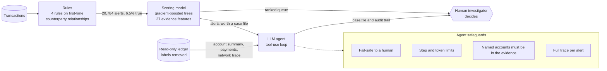

# AML Sentinel

[](https://github.com/mathukumillidivya/aml-sentinel/actions/workflows/tests.yml)

Money-laundering alert triage, measured on the public IBM AML benchmark. Rules
raise alerts, a scoring model ranks them, an LLM agent writes the case file, and
a person decides.

**Live demo:** https://aml-sentinel-app.netlify.app (a case desk that replays the agent's
investigation of 300 held-out alerts on a payment map, plus the results)

| On held-out test days | HI-Small | LI-Small (nothing re-tuned) |
|---|---|---|
| Alerts from rules alone | 20,784, of which 93.5% false alarms | 27,297, of which 96.6% false alarms |
| Alert-volume cut keeping 80% of true alerts | 73% | 68% |
| Alert-volume cut keeping 90% | 60% | 61% |
| True alerts from labeled schemes in the alerts read first | 768 of 786 | 221 of 245 |

**Findings**

- **Ranking.** Rules plus a gradient-boosted model cut the number of alerts to review
  by 73% while keeping 80% of true alerts. This is alert volume on the benchmark;
  investigator time was not measured. On a second dataset the cut is 68%, and the
  first dataset's model applied unchanged gives 67%.
- **The agent is not the scorer.** On 300 held-out alerts the LLM agent ranked
  worse than the model (AUC 0.68 against 0.81; gap −0.13, 95% CI −0.19 to −0.07).
  Averaging the two was worse than the model alone. A stronger LLM and a
  retrieval step did not change this.
- **The agent writes the case file, faithfully.** A mechanical check of every
  account and dollar figure it wrote found 95% of case files fully traceable to
  the evidence it retrieved, and 813 of 814 named accounts in that evidence.
- **What it misses.** 23% of laundering transactions never reach an alerted
  account (37% on the second dataset), and the agent names the right scheme type
  for only 7 of 47.

## Architecture



- **Rules** stay as the auditable net. None uses the payment format.
- **Scoring model** ranks every alert at no cost per alert.
- **Agent** investigates with tools and writes the evidence up. It recommends; it does not decide.
- **Evaluation** uses a time split (tune on days 4-5, report on days 7-9), stratified
  samples re-weighted to the true mix, and confidence intervals on every rate.

## The problem

Banks monitor transactions with threshold rules. The rules are cheap and easy to
audit, but they flag large numbers of innocent customers, and every alert is
reviewed by a person.

## Results on the IBM AML benchmark (HI-Small)

Dataset: [IBM Transactions for Anti Money Laundering](https://www.kaggle.com/datasets/ealtman2019/ibm-transactions-for-anti-money-laundering-aml)
(Altman et al., NeurIPS 2023). 5.08M transactions, 1 in 1,000 laundering, 370 labeled schemes.

Protocol (`src/ibm_data.py`): days 0-3 are history, days 4-5 development, day 6 a
gap, days 7-9 held-out test. Everything below is on the held-out days.

**Rules only** (`src/ibm_rules.py`). Four rules built on first-time counterparty
relationships; none uses the payment format.

| Measure | Value |
|---|---|
| Alerts | 20,784 (about 6,900 a day) |
| True alerts | 1,360 (6.5%) |
| False alarms | 19,424 (93.5%) |
| Laundering transactions on an alerted account | 1,018 of 1,318 (77%) |
| Labeled schemes touched | 160 of 207 |

**Rules + scoring model** (`src/ibm_model.py`). Gradient-boosted trees on 27
evidence features, trained on development days. Alerts are reviewed from the
highest score down.

| To keep this share of true alerts | Alerts to review | Alert-volume cut | Precision |
|---|---|---|---|
| 50% | 955 | 95% | 71% |
| 80% | 5,554 | 73% | 20% |
| 90% | 8,232 | 60% | 15% |
| 95% | 9,495 | 54% | 14% |

AUC 0.896, average precision 0.625 (rules alone: 0.065).

Robustness checks:

| Check | AUC | Alert-volume cut at 80% retention |
|---|---|---|
| All features | 0.896 | 73% |
| Payment-format features removed | 0.893 | 73% |
| Only accounts never alerted during development | 0.858 | 64% |
| Ranking by number of rules fired (no model) | 0.464 | 19% |

Dataset quirks handled, each of which would otherwise inflate results:

- **Date leak.** After day 10 nearly every transaction is laundering. Those days are dropped.
- **Format leak.** 85% of laundering moves by ACH, which is 12% of volume. Rules ignore
  the format, and the model is reported with and without it.
- **Hub accounts.** 15 accounts with over 2,000 transactions each touch 10% of all
  transactions. They are excluded from alerting and scoring, which also removes 633
  laundering transactions from scope.
- **Self-transfers.** 591,212 payments from an account to itself are dropped.
- **Currencies.** Amounts are converted to USD with rates implied by the dataset's own
  cross-currency payments.

Limits: these are alert-level results on accounts, so they are not comparable with
the transaction-level F1 scores in the graph-neural-network literature. 23% of
laundering transactions never reach an alerted account, and the model cannot recover
what the rules miss. Two of the six IBM variants are covered.

### Replication on a second dataset (LI-Small)

`src/ibm_replicate.py` runs the identical pipeline on LI-Small (6.92M
transactions, laundering about 1 in 1,700, 117 labeled schemes): same rules,
features, model settings, and time split, with nothing re-tuned. It also applies
the model trained on HI-Small, unchanged, to LI-Small's test days.

| Held-out test days | Alerts | False alarms | AUC | Alert-volume cut keeping 80% | Keeping 90% |
|---|---|---|---|---|---|
| HI-Small | 20,784 | 93.5% | 0.896 | 73% | 60% |
| LI-Small, model trained on LI-Small | 27,297 | 96.6% | 0.840 | 68% | 61% |
| LI-Small, payment-format features removed | 27,297 | 96.6% | 0.837 | 67% | 61% |
| LI-Small, HI-Small's model applied unchanged | 27,297 | 96.6% | 0.829 | 67% | 58% |

On LI-Small the rules reach 63% of laundering transactions (77% on HI-Small),
and 221 of 245 true alerts from labeled schemes fall in the alerts read first
(768 of 786 on HI-Small). The result holds, at a somewhat lower level, and the
model transfers between datasets with little loss. Both datasets come from the
same simulator, so this is weaker evidence than a second, independent source
would be.

### Does the agent add anything to the model?

The model sets aside the alerts it is confident are ordinary. The remaining
"review band" on the test days is 9,249 alerts holding 1,275 of the 1,360 true
alerts (94%). The agent investigated a stratified sample of 300 of them
(`src/ibm_agent.py`, `src/ibm_agent_eval.py`). Its instructions, tools, and
escalation cut-off were fixed on development days before the test ran.

| Ranking of the same 300 alerts | AUC | Share of band to read to keep 80% of true alerts |
|---|---|---|
| Scoring model alone | 0.810 | 45% |
| Agent alone (Claude Haiku 4.5) | 0.682 | 67% |
| Average of the two | 0.785 | 51% |

- Agent minus model: AUC −0.128 (95% CI −0.190 to −0.066).
- Average minus model: AUC −0.025 (95% CI −0.052 to −0.002).
- The agent escalated 48 of 120 true alerts (40%) and dismissed 163 of 180 false
  alarms (91%), leaving 14% of the band for humans. The model alone keeps the
  same 40% of true alerts in 5.5% of the band.
- The agent's confident flags (risk 50+) were 52% precise. The model's top slice
  of the same size was 79% precise.
- Stronger model: Claude Sonnet 5.5 on 100 of the same alerts scored AUC 0.657,
  against 0.613 for Haiku and 0.739 for the scoring model on those alerts.
- Network: the agent named 221 linked accounts, 86% of them correct, and found 16%
  of labeled scheme members. Returning everything the trace tool finds gives 81%
  correct and 23% found, so the agent's filtering trades recall for a little precision.
- Operations: 2 fail-safe escalations in 300, 3.7 tool calls, about 13,500 input and
  1,600 output tokens, roughly 2 cents and 18 seconds per alert.

Why the agent lost: the model learned from 18,827 labeled development alerts what
laundering looks like in this data. The agent has a page of guidance and its own
priors. In the first development run it escalated bursts of incoming payments as
"fan-in" schemes, which here occur at the base rate. Told so, it compressed most
scores into a narrow range and lost resolution. Development runs showed the same
gap before the test (AUC 0.78 against 0.92, then 0.80 against 0.84).

### What the agent is good at: case files that stick to the evidence

`src/ibm_faithfulness.py` checks every account ID and dollar figure in the
agent's narrative and evidence list against what the agent was shown (its
starting case file plus every tool result). No second model is involved.

| Check on the held-out case files | Claude Haiku 4.5 (298 files) | Claude Sonnet 5.5 (100 files) |
|---|---|---|
| Accounts named that were in the evidence | 813 of 814 | 288 of 288 |
| Dollar figures found as written | 97.5% of 1,121 | 99.5% of 578 |
| Dollar figures that are sums of listed payments | 1.2% | 0% |
| Dollar figures not traceable | 1.3% (15) | 0.5% (3) |
| Case files with nothing untraceable | 95% (283 of 298) | 97% (97 of 100) |

All 15 untraced Haiku figures were read by hand: differences, rounded limits,
and currency conversions, none an obviously invented amount. The check confirms
a figure exists in the evidence, not that the sentence around it is correct.

### What did not work

- **Naming the scheme type.** Right for 7 of 47 escalated alerts in a labeled
  scheme (Haiku) and 0 of 16 (Sonnet). One account's neighbourhood does not show
  the shape of a whole scheme.
- **Retrieval.** `src/ibm_cases.py` shows the agent the 25 most similar
  development-period alerts and their outcomes. Offline, those neighbours alone
  score AUC 0.74 in the review band against the model's 0.80. In a 50-alert
  development trial the agent scored 0.77 with them and 0.79 without, on the
  same alerts, so the idea was not taken to the held-out test.

What this does not show: whether the agent's written case files save an
investigator time. That needs human raters and is not measured here.

## The agent

`src/agent.py` runs a tool-use loop: the model reads the alert, picks tools,
reads the evidence, and submits a structured verdict (disposition, risk score,
typology, evidence, innocent explanation considered, linked accounts, narrative).

| Property | Guarantee |
|---|---|
| Fail-safe | Any error, timeout, or missing verdict escalates to a human |
| Bounded | Max 8 model turns and 16 tool calls per alert; token budget per run |
| Grounded | Accounts named in a verdict must appear in tool output |
| Auditable | Full trace of tool calls, results, and reasoning per alert |
| Blind | Ground-truth labels never reach the tools or the model |

Models are swappable (`src/models.py`): Claude, OpenAI, or an offline mock used
by the tests. Evaluation uses a stratified sample re-weighted to the true alert
mix, with 95% Wilson confidence intervals on every rate.

## Investigator review screen

`app/review.html` is a single self-contained page (`python src/build_review_screen.py`
rebuilds it). It shows the 300 held-out alerts the agent investigated: the queue
ranked by the scoring model, and for each alert the activity summary, the
first-time payment network, the agent's case file and audit trail, and decision
buttons. A results view carries the measured figures and an alert-volume calculator.
Benchmark labels stay hidden until the viewer asks for them.

`app/site/index.html` is the standalone build served at the demo address: an
investigation console where the payment network around an alert is drawn as a
map, the agent's recorded tool calls are replayed onto it, and its case file is
written beside it. `python src/build_console.py` rebuilds it from the data
packed into `app/review.html`, so the two pages always show the same numbers. A second
build, `app/review.html`, adds a live agent that can be run on any case when the
page is hosted on a platform that provides a model runtime.

## Earlier work on synthetic data

The agent was first built against a synthetic dataset written for this project.
It looked strong there (74% fewer alerts at 82% of true alerts kept) because its
tools matched how that data was generated. The IBM benchmark showed the
advantage did not carry over. Details: [docs/synthetic-sample.md](docs/synthetic-sample.md).

## Run it

```bash
pip install -r requirements.txt
python -m pytest tests                # 66 tests, no API key needed

# synthetic sample pipeline
python src/generate_data.py
python src/rules_baseline.py && python src/evaluate.py
python src/run_agent.py --provider mock --n 40          # offline dry run
export ANTHROPIC_API_KEY=...                            # never commit this
python src/run_agent.py --provider anthropic --n 20
python src/evaluate_agent.py --run <run_id>

# IBM benchmark (needs the Kaggle download in data/ibm/)
python src/ibm_prepare.py             # raw CSV -> data/ibm_prepared/
python src/ibm_rules.py               # results/ibm/rules_baseline.json
python src/ibm_model.py               # results/ibm/model_baseline.json
python src/ibm_replicate.py --name LI-Small   # second dataset; needs data/ibm_prepared_LI-Small/
python src/ibm_agent.py --provider anthropic --split test --n-true 120 --n-false 180
python src/ibm_agent_eval.py --run <run_id>
python src/ibm_faithfulness.py --run <run_id>
```

Each stage also has a workflow under the Actions tab, which reads keys from
repository secrets.

## Layout

- `src/ibm_prepare.py`, `ibm_data.py`, `ibm_rules.py`, `ibm_features.py`, `ibm_model.py`: IBM benchmark pipeline
- `src/ibm_tools.py`, `ibm_agent.py`, `ibm_agent_eval.py`: the agent on IBM data and its comparison with the model
- `src/ibm_faithfulness.py`: checks the agent's case files against its evidence
- `src/ibm_cases.py`: library of past cases for retrieval
- `src/generate_data.py`, `rules_baseline.py`, `evaluate.py`: synthetic sample pipeline
- `src/ledger.py`, `tools.py`: read-only data access and the nine investigation tools
- `src/agent.py`, `models.py`: the agent loop and provider adapters
- `src/run_agent.py`, `evaluate_agent.py`: run and score the agent
- `src/build_review_screen.py`, `app/`: the investigator review screen
- `tests/`: automated tests
- `docs/`: notes on the earlier synthetic-data work
- `results/`: every number quoted above, as produced by the code

## Data and licence

- Code: MIT (see `LICENSE`).
- Data: [IBM Transactions for Anti Money Laundering](https://www.kaggle.com/datasets/ealtman2019/ibm-transactions-for-anti-money-laundering-aml),
  Altman et al., NeurIPS 2023, released under CDLA-Sharing-1.0. The benchmark is
  synthetic and contains no real customers. Files derived from it in this
  repository are listed in `DATA.md` and carry the same licence.

Every figure in this README is produced by code in this repository and stored
under `results/`.
